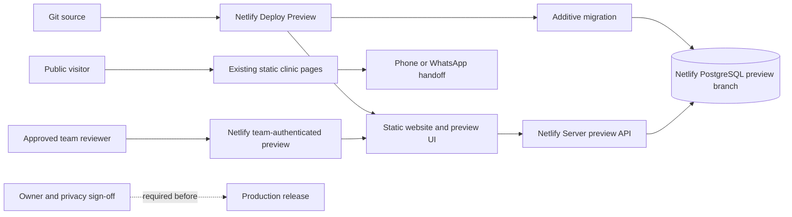
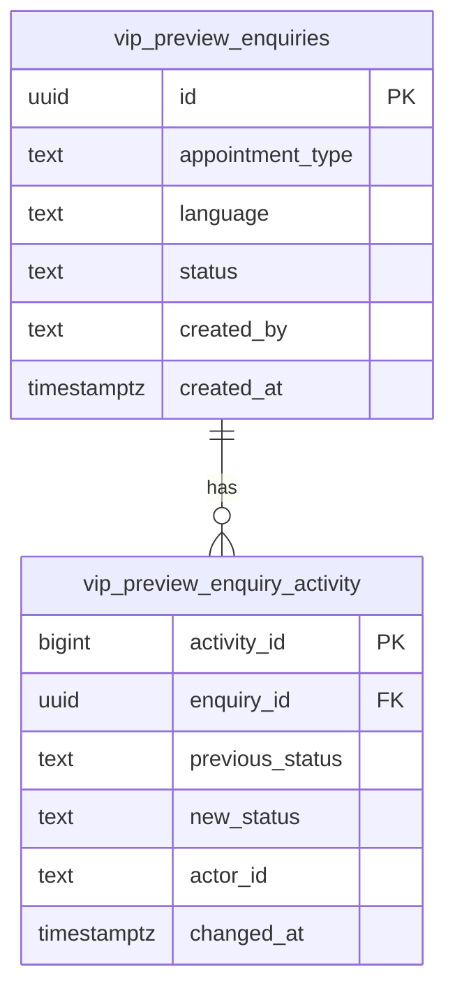

# VIP Magical Physio — Release 1 baseline and handover

**Assessment date:** November 25, 2026. **Phase:** Release 1, preview implementation. **Production acceptance: not granted.** No patient records, paid subscriptions, payment credentials, or clinical approvals were created or used in this phase.

## Existing project and capabilities

The live baseline returned HTTP 200 for the home page, booking, services, contact, `/en/`, `/mr/`, `/hi/`, robots and sitemap. `/admin` returned 404. The published build was based on `85364ac`; the deploy reported publication on November 23, 2026. The checked-out repository contains overlapping root-site, design-handoff and active `site/` trees. Netlify's publish script copies `site/`, legacy `services/` and selected root assets into `public/`. The old root admin is not an authenticated team tool and is not published. Don't deploy the repository root as a drag-and-drop site.

| Capability | What was established | What remains |
| --- | --- | --- |
| Website, GitHub, hosting | Live HTTPS read access and Git working tree available; active Netlify publish configuration inspected; production deployment untouched | Preview deployment check and owner production approval |
| Domain and DNS | Custom domain and HTTPS reachable; project settings report managed DNS | DNS changes not authorized or tested; none needed for this slice |
| Appointment/contact | Existing forms prepare manual WhatsApp messages; displayed times are preferences, not availability; existing working routes retained | Phone/WhatsApp delivery and mobile-device smoke tests not run; no live slots or booking confirmation |
| Netlify Database | Project reports provisioned; new additive migration and parameterized queries exercised on a local Postgres engine | Managed preview branch and migration still require verification; no production DB read, dump, or restore performed |
| Netlify Server | Routed implementation added; installed toolchain met early-access Node/CLI minimums | Verify exact account eligibility, build runtime and protected preview context before using the API |
| Authentication | Project reports Netlify Identity configured; preview uses Netlify team context, not Identity | No real owner/staff authentication verified; preview needs team-identity access, not just a shared password. Production roles are not implemented |
| File storage/backups | Source baseline archive extracted and compared; no business files handled | Private ebook/clinical storage, managed DB recovery, recovery coverage and encryption settings not verified |
| Analytics and SEO | GA4 measurement ID and spreadsheet webhook absent from active client configuration; 43 baseline sitemap entries observed; localized hubs linked publicly | Search Console, Google Business Profile, attribution and conversion metrics not verified; no device Lighthouse scores |
| Email, WhatsApp API, SMS, calendar, payments, AI | No third-party connections authorized in this phase. Public click-to-WhatsApp is not an API integration | Provider, permissions, costs, consent, templates and end-to-end evidence required by release |

The audit found that legacy lead code saved contact and enquiry details to browser storage and treated an opaque webhook response as success if configured. That code path was removed rather than fixed. Existing browser copies are cleared on a subsequent visit using the updated script; the change cannot retroactively remove browser history, shared copies, or WhatsApp messages. Individual condition drafts were publicly readable despite `noindex`. The new generator withholds detailed pages until each language has a dated clinical sign-off. A legacy services directory remains available; its older content, homepage translations and clinic details still need owner review. No clinical review was fabricated.

## Architecture and decisions

| Option | Decision |
| --- | --- |
| Existing static HTML/CSS/JS | Keep; preserves URLs, hosting, multilingual generator and low maintenance. |
| Netlify Server + native Netlify Database | Add only for first-party preview workflow; no ORM or external database, portable SQL. Server is early access; validate plan and availability, and reassess if unsuitable. |
| React/Next.js rebuild, Hostinger migration, external backend/CRM | Defer; no demonstrated benefit justifies migration, additional subscriptions or duplicated patient contact data. |
| Google Sheets webhook | Reject for receiving patient enquiries: the prior browser-only storage and opaque success determination weren't a dependable CRM. |

The preview API reads up to 50 recent rows, accepts only fixed appointment/language values with a retry reference, and records status transitions in the same SQL statement as the update. No names, phone numbers, free text, diagnoses or treatment data are accepted. Acting user identifiers come from Netlify context; the app doesn't display those identifiers. The API is unavailable outside the `deploy-preview` context. The inbox is for approved reviewers collectively, not a production owner/staff role model. Deployment preview isolation is not de-identification: Netlify documents preview branches as copies of production. Before storing real records, confirm existing DB contents and a staging strategy that does not expose a production data copy to preview reviewers. Have the owner approve preview access and expiry even for reviewer identity metadata.

**Exit strategy:** Static pages and portable PostgreSQL schema can move independently. Rehost the request handler behind an equivalent server-side access check and swap the SQL adapter; migrate any approved future business data with encrypted PostgreSQL exports, row-count/constraint checks and restore validation. Keep public call/WhatsApp fallback available through a migration. Never reuse test data, connection credentials, or plaintext exports on another provider.

## Feature and dependency register

Business value and risk are qualitative pending actual enquiry and workload data; time saved and revenue are not measured. Budgets are estimates and are not approvals.

| Priority and release | Status | Value and acceptance gate | Cost/risk and dependencies |
| --- | --- | --- | --- |
| P0 · R1 public acquisition and consent copy | Implemented but unverified on the revised deploy | Users can make contact without waiting for a system; verify WhatsApp handoff, phone links and booking copy in all languages | Low implementation/recurring cost; medium privacy risk through third-party messaging; owner verifies details and approves copy |
| P0 · R1 multilingual publication | Complete and verified locally for generated drafts; revised deploy unverified | Existing locales remain; no draft content emitted as detail pages, safe legacy fallback and approved sitemap entries | Low technical complexity; high clinical accuracy importance; owner must review each locale and date the review |
| P0 · R1 preview inbox | Implemented but unverified on Netlify | Synthetic request → durable row → inbox → contacted/closed with audit event; verify team gate and production denial on deployed preview | Moderate implementation; shared-preview identity and usage risks; budget zero new subscriptions pending eligibility |
| P0 · R1 production lead capture/owner dashboard | Blocked for launch | Minimal contact and consent, server validation, abuse throttles, owner-only permissions and correction/deletion; verify policy, duplicates and outage fallback | Medium complexity/high privacy risk; requires signed-off data fields/retention, preview separation, managed DB backup test and owner acceptance |
| P1 · R2 CRM/appointments, notifications, calendar and ledger | Not implemented | Retain lead history and manual fallback; prove conflict-safe approvals, time zone, cancellation and delivery evidence; reconcile collected/manual amounts | Medium to high cost/risk; prerequisite R1; approved scheduling rules, consent and authorized providers |
| P1 · R3 ebooks, payments, orders | Not implemented | Revenue capability depends on verified payment and authorized delivery; sandbox duplicate webhook, refund, reconciliation and expiring download tests | High integration/risk; needs owner-approved prices/products, merchant onboarding and permissions; variable transaction/storage costs |
| P2 · R4 clinical records, library and Recovery Passport | Not implemented | Clinician control, record isolation, versioned notes, protected QR and restoration tests | High complexity and clinical/privacy risk; requires separate access design and professional/legal sign-off |
| P2 · R5 durable automation and AI | Not implemented | Manual operations remain usable; idempotent jobs, provider delivery evidence, escalation and human review | Ongoing provider/messaging/AI cost; require cost caps and demonstrable savings; no identifiable health data sent to AI |
| P2 · R6 patient portal and optimization | Not implemented | Zero cross-patient access, real mobile audit, incident/restore drill and performance measurement | High maintenance/risk until earlier releases are proven; avoid portal if security budget is insufficient |

Release dependency order: **public handoff and reviewed content → secure lead intake and owner access → appointments/CRM → digital sales → clinical records → AI/advanced automation → patient portal.** Each row requires a priced scope, named reviewer, acceptance evidence and owner approval before production launch. An owner-managed CMS is deferred; this phase adds a source-level approval gate, not a nontechnical CMS.

## Financial feasibility

No new spend was initiated; actual invoices, credit balance and current monthly spend were not accessible. As a public reference, [Netlify pricing](https://www.netlify.com/pricing/) listed Personal at $9/month with 1,000 credits and Pro starting at $20/month with 3,000 credits; this does **not** establish that the current project is billed at that amount or uses that credit tier. [Netlify Database documentation](https://docs.netlify.com/build/data-and-storage/netlify-database/) described credit use for active database compute and bandwidth and an introductory storage policy; verify current meter rates, storage limits, backup windows and dashboard eligibility before accepting traffic. Netlify Server early-access billing and eligibility can change. Gateway and communication fees are unverified for this merchant, so no amount was committed.

| Configuration | Estimated one-time | Estimated running per month / year | 3-year incremental estimate |
| --- | ---: | ---: | ---: |
| A · Minimum: keep existing hosting, manual contact, synthetic preview only | ₹0–₹5,000 | ₹0–₹300 / ₹0–₹3,600 | ₹0–₹15,800 |
| B · Recommended: production intake, owner dashboard, approved notifications, managed recovery | ₹5,000–₹20,000 | ₹500–₹2,500 / ₹6,000–₹30,000 | ₹23,000–₹110,000 |
| C · Later: clinical isolation, store, automation, monitoring and support | ₹30,000–₹150,000 | ₹3,000–₹15,000 / ₹36,000–₹180,000 | ₹138,000–₹690,000 |

These are incremental planning allowances, not provider quotes or estimates of total labor at a specific rate. The 36-month totals add one-time cost and 36× monthly cost, excluding existing subscriptions, tax, transaction fees, domain renewals, clinic labor and usage overruns. As a separate illustration, an unchanged $20/month plan would total $720 over 36 months before taxes/overages. For B, reserve recurring budget for hosting/compute, messaging and backup/maintenance; for C, add storage/download traffic, payment fees, incident and migration support, and a fixed AI allowance only if approved. Foreseeable cost drivers: credit compute/bandwidth and retention for intake; per-recipient messages and scheduler for appointments; verified-payment volume × contract fee plus tax and download egress for the store; encrypted storage, logs and staff access for clinical work; tokens and jobs for AI. Obtain India-region provider quotes and volume inputs before cost commitments. Keep automatic credit recharge disabled unless specifically approved; use platform alerts and review usage before opening real intake. No alert settings were changed.

## Privacy, QA and deployment

This is not a legal determination. The Digital Personal Data Protection Act, 2023, the Digital Personal Data Protection Rules, 2025, associated Gazette commencement notifications/corrections, professional rules and consumer/payment requirements need review by qualified Indian counsel. The binding text and exact effective obligations were not independently verified in this phase; do not treat existing copy as a consent or compliance sign-off. Before real capture, approve notices, purposes, processor and cross-border review, retention, handling of guardian requests, correction/deletion/export, incident reporting and breach response. Store clinical records separately and do not ask patients to enter health history in an acquisition form.

| Test IDs | Expected and observed | Result and evidence |
| --- | --- | --- |
| P0-01–02 | Production, unauthenticated and cross-origin requests denied; invalid/oversize payloads and unexpected fields rejected | Pass · `tests/enquiries.test.mjs` |
| P0-03–04 | Repeated submit persisted one row; conflicting/stale updates rejected; audit rows matched valid status changes | Pass · same file, migration applied locally to isolated PGlite |
| P0-05 | Database failure returned 503 without internals or success | Pass · same file |
| P0-06–07 | Legacy storage keys removed without deleting preferences; public forms no longer include local lead capture or default to query-string submission | Pass · `tests/public-enquiries.test.mjs` |
| P0-08–09 | Draft detail pages omitted; fallback present; all locales must be dated and reviewed; actual review date recorded | Pass · `tests/condition-publication.test.mjs` |

Local execution by the coding agent on November 25, 2026: `npm test`, `npm audit --omit=dev --audit-level=high`, `git diff --check`, shell syntax and JavaScript syntax checks. The production URL baseline was checked independently of those tests. The actual Netlify database/SSO handshake, routing and migration, browser/device QA, deployed-site Lighthouse, approvals, integration or production E2E tests and production DB restore were not run. Patient data isolation and booking/payment gates cannot pass until those features exist. No production deployment was made or claimed.

## Owner runbook and next actions

1. **Developer:** Verify the automated Deploy Preview and migration. Test `/owner-preview` as signed-out and with an authorized team reviewer; a shared site password alone does not establish an individual identity. If preview-only team access is unavailable on the current plan, keep the API fail-closed and scope distinct invite-only app access; do not make the public site private. Confirm `/api/preview/enquiries` returns 404 in production before any production promotion, and keep the preview synthetic.
2. **Owner and clinician:** Verify contact, hours, service area and appointment language. Review each clinical locale before setting `reviewed: true` and `reviewedOn: YYYY-MM-DD` on the corresponding three content entries. Do not change flags without actual review or publish unapproved translations. Confirm which Netlify team reviewers may see the preview and who owns follow-up calls.
3. **Owner and counsel:** Approve the privacy/retention workflow, processor arrangements and approved production fields. Review plan credits and name the emergency and data-rights contacts. Production owner roles, rate limits, verified backups and privacy procedures remain launch blockers for real intake.
4. **Developer:** Run staged device and abuse tests; verify the phone and WhatsApp manual paths on a real phone; scope managed database recovery with a test entirely separate from production. Suggested planning targets for real lead intake: RPO ≤24 hours and RTO ≤4 hours, subject to verified provider capabilities and owner approval. Record recovery history and review monthly after launch.
5. **Owner:** Approve promotion only after staging evidence and rollback are reviewed. For the manual workflow, read WhatsApp, check availability by phone or the clinic’s approved calendar, and send a separate confirmation. To try the preview, create a sample, refresh, mark it contacted or closed; no notifications are sent. If the inbox fails, confirm the access state and database health rather than assuming any live lead is missing—the public handoff is independent.

**Rollback:** The source baseline was archived before changes; extraction and comparison of the homepage and legacy JavaScript against `85364ac` passed. The archive is temporary; use the tracked Git revision for durable source recovery. If an approved deployment regresses, approve republishing the last known good Netlify deploy and verify that the public handoff works. The migration is additive; republishing a deploy does not undo a schema migration. Do not drop a table as part of web rollback. Plan separate approved cleanup of synthetic test branches after evidence is retained. Reverting the clinical gate could re-expose drafts; keep those paths unpublished during a recovery. No data restore claim is made.
